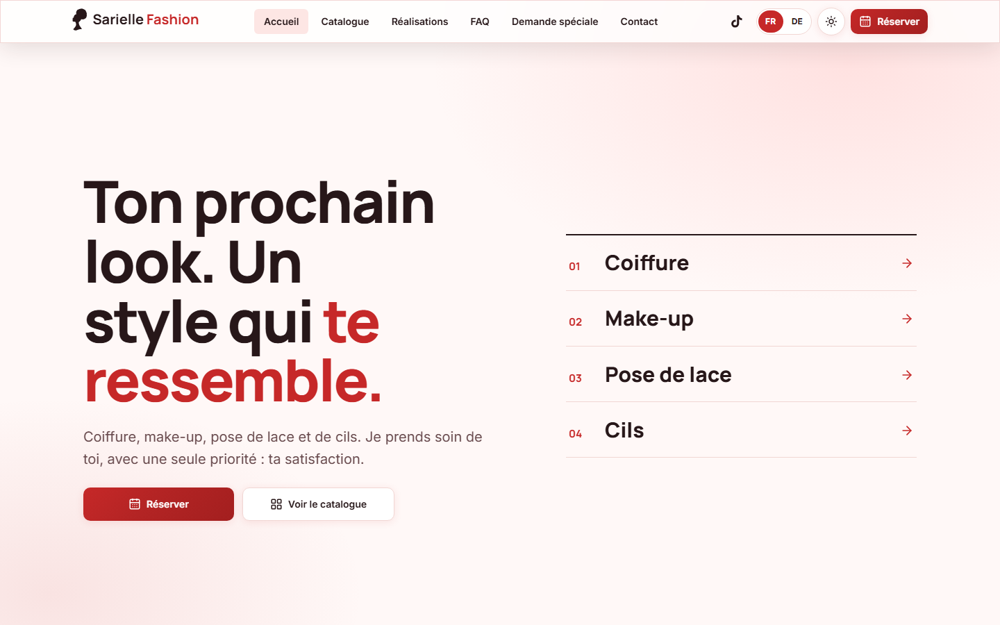
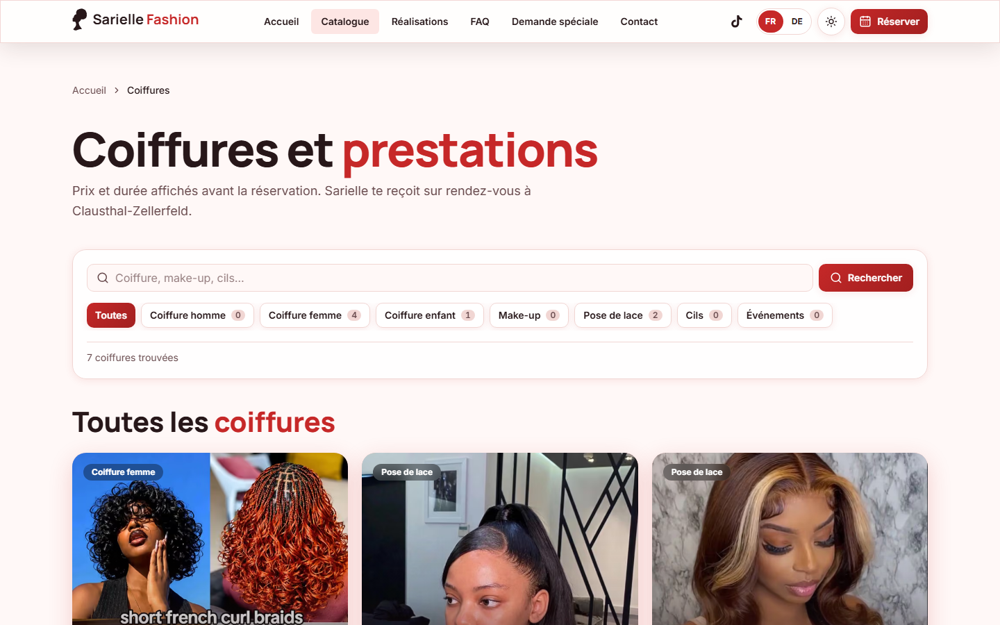
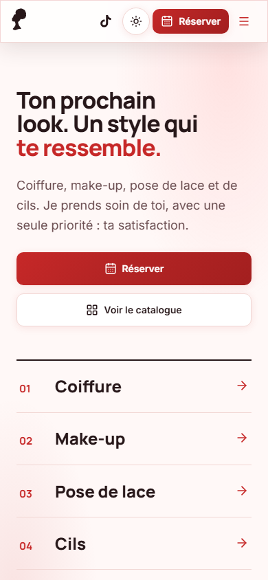
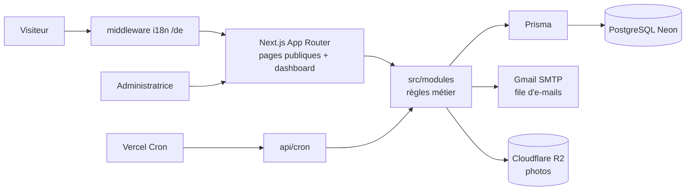
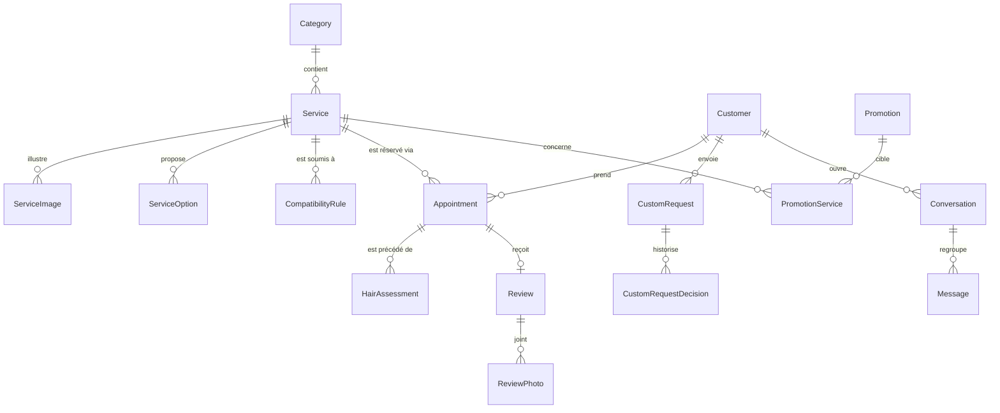
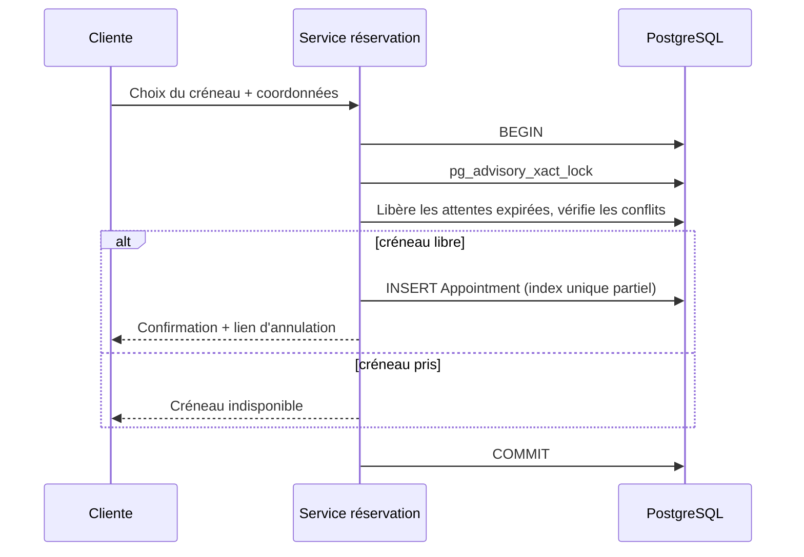

# Sarielle Fashion

**Site vitrine, réservation en ligne et back-office pour un salon de coiffure, make-up, pose de lace et de cils à Clausthal-Zellerfeld (Allemagne).**

[](https://sariellefashion.vercel.app)
[](https://sariellefashion.vercel.app)


[](LICENSE)

Démo en ligne : <https://sariellefashion.vercel.app> (français) · <https://sariellefashion.vercel.app/de> (allemand)

> Projet réalisé pour une cliente réelle. Le code est public à titre de portfolio ; il reste sous licence propriétaire (voir [Licence](#licence)).

## Contexte, problème, solution

**Contexte.** Sarielle Fashion est un salon indépendant (coiffure femme, homme et enfant, make-up, lace, cils, événements, déplacement à domicile possible) installé à Clausthal-Zellerfeld, en Basse-Saxe.

**Problème.** Les rendez-vous passaient par messagerie et téléphone : risque de doubles réservations, questions répétitives sur la compatibilité d'une coiffure avec le type de cheveux, aucune vision centralisée des demandes, clientèle francophone et germanophone.

**Solution.** Un site bilingue (FR / DE) avec catalogue de prestations, parcours de réservation guidé, évaluation de compatibilité capillaire, demandes sur mesure, messagerie et un back-office pour gérer le tout. Le paiement se fait sur place : le site ne traite aucune donnée de paiement.

## Fonctionnalités

**Côté public**

- Accueil, catalogue de prestations (prix en euros, durée, photos) et fiches détaillées.
- Réservation en ligne en plusieurs étapes, créneaux protégés contre la double réservation, option coiffure à domicile avec frais de déplacement.
- Annulation par lien sécurisé à durée limitée, délai de préavis configurable.
- Évaluation de compatibilité capillaire (questions conditionnelles, photo privée).
- Demandes de coiffure personnalisées avec photos de référence, liste d'attente.
- Avis clients, galerie, FAQ, informations pratiques, mentions légales, politique de confidentialité.
- Thème clair / sombre, responsive, interface FR et DE.

**Côté back-office (`/dashboard`, français uniquement)**

- Prestations, catégories, options, photos, règles de compatibilité, promotions.
- Disponibilités hebdomadaires, périodes bloquées, calendrier (jour, semaine, mois, liste).
- Réservations (machine à statuts, reprogrammation), clients, demandes, évaluations.
- Messagerie centralisée, notifications, statistiques, journal d'audit, paramètres du salon.

## Captures d'écran

Captures du [site en production](https://sariellefashion.vercel.app) (pages publiques uniquement, aucune donnée personnelle ni back-office).

| Accueil (bureau)                                         | Catalogue (bureau)                                              | Accueil (mobile)                                        |
| -------------------------------------------------------- | --------------------------------------------------------------- | ------------------------------------------------------- |
|  |  |  |

Restent à produire à partir d'un jeu de données de démonstration (`npm run db:seed:demo`) : fiche prestation, parcours de réservation, version allemande, calendrier du back-office, tableau de bord.

## Stack

Versions déclarées dans [`package.json`](package.json) (plages semver) ; Node 22 minimum.

| Couche            | Choix                                                                    |
| ----------------- | ------------------------------------------------------------------------ |
| Framework         | Next.js 15.5 (App Router, Turbopack en dev), React 19, TypeScript strict |
| Style             | Tailwind CSS 4, composants personnalisés, lucide-react et react-icons    |
| Base de données   | PostgreSQL hébergé sur Neon, Prisma 6                                    |
| Authentification  | Auth.js (next-auth 5 bêta), identifiants + bcryptjs (coût 12)            |
| Validation        | Zod 4                                                                    |
| E-mails           | Nodemailer via SMTP Gmail (mode console en développement)                |
| Fichiers          | Cloudflare R2 (API S3, URL présignées), traitement d'images avec sharp   |
| Tests             | Vitest 5 (unitaires), Playwright (E2E)                                   |
| Qualité           | ESLint 9, Prettier 3, Husky + lint-staged, Dependabot                    |
| Hébergement, cron | Vercel (4 tâches planifiées, voir [`vercel.json`](vercel.json))          |

## Architecture

Le code métier vit dans `src/modules/<domaine>` (17 domaines : réservations, catalogue, compatibilité, disponibilités, messagerie, notifications, avis, RGPD...) et ne dépend jamais de `src/app`. Détails : [docs/architecture.md](docs/architecture.md).



## Modèle de données

26 modèles et 13 enums Prisma ([`prisma/schema.prisma`](prisma/schema.prisma)), 16 migrations. Vue simplifiée des entités principales :



S'y ajoutent `AvailabilityRule`, `BlockedPeriod`, `Notification`, `AuditLog`, `WaitlistEntry`, `GalleryPhoto`, `SalonSettings`, `RateLimitBucket` et `User`.

## Réservation et verrou anti double-réservation

Deux protections complémentaires empêchent deux clientes de prendre le même créneau :

1. **Verrou transactionnel** : la création et la reprogrammation s'exécutent dans une transaction qui prend un verrou consultatif PostgreSQL (`pg_advisory_xact_lock`) avant de vérifier les conflits ([`src/modules/reservations/service.ts`](src/modules/reservations/service.ts)).
2. **Index unique partiel** sur `(serviceId, startsAt)`, limité aux rendez-vous non annulés (migration `20261022000000_slot_unique_active_only`). Un créneau annulé redevient réservable ; un doublon actif est rejeté par la base elle-même.

Une réservation en attente porte une échéance (`holdExpiresAt`) : passé ce délai, le créneau est libéré automatiquement. Prix et durée sont figés sur chaque réservation (instantané).



## Internationalisation FR / DE

- Français par défaut, sans préfixe ; allemand sous `/de`. `src/middleware.ts` réécrit `/de/...` vers la même route interne : pas de dossier `[locale]`.
- Dictionnaires typés (`src/i18n/messages/{fr,de}`) : une clé allemande manquante fait échouer `tsc`.
- Métadonnées localisées avec canonical et hreflang `fr` / `de` / `x-default` (pages et sitemap), image Open Graph générée dans chaque langue.
- E-mails clients rendus dans la langue de la demande ; back-office en français.
- Les contenus saisis par l'administratrice ne sont pas traduits automatiquement.

Voir [docs/i18n.md](docs/i18n.md).

## Tests

- **Unitaires (Vitest)** : 54 fichiers `*.test.*` (moteurs de compatibilité et de disponibilités, machine à statuts, idempotence des notifications, schémas Zod, i18n). Nombre de cas exact : voir la sortie de `npm test`.
- **E2E (Playwright)** : 15 fichiers dans `tests/e2e` (parcours visiteur et admin, responsive, SEO, sécurité, thème, i18n). Ils nécessitent une base PostgreSQL de test et ne tournent pas sur GitHub Actions.
- **Chaîne CI** : `npm run ci` exécute typecheck, Prettier, ESLint, Vitest et le build ; elle est aussi déclenchée par le hook pre-push. Le même enchaînement tourne sur GitHub Actions ([`.github/workflows/ci.yml`](.github/workflows/ci.yml)).

## Démarrage local

```bash
npm install
cp .env.example .env.local   # renseigner les variables (noms uniquement dans le dépôt)
npx prisma migrate dev
npm run db:seed:demo         # données de démonstration
npm run dev                  # http://localhost:3000
```

Avec `EMAIL_MODE="console"`, aucun e-mail réel n'est envoyé. Les routes cron sont protégées par `CRON_SECRET`. Utiliser une branche Neon dédiée en développement, jamais la base de production.

## Déploiement

Hébergé sur Vercel, déployé depuis `main` uniquement. Le build applique les migrations (`prisma migrate deploy` via `DIRECT_URL`, sans verrou advisory) puis lance `next build`. Quatre tâches cron (notifications, rappels H-24, rétention RGPD, liste d'attente) sont déclarées dans `vercel.json`. Procédures : [docs/maintenance.md](docs/maintenance.md).

## Difficultés rencontrées

- **Double réservation** : une simple vérification ne suffit pas sous concurrence ; combinaison verrou consultatif + index unique partiel. Prisma ne sait pas exprimer l'index partiel : il est écrit en SQL dans la migration.
- **Migrations sur Vercel** : le verrou advisory de Prisma expirait derrière le pooler Neon ; les migrations passent par la connexion directe avec le verrou désactivé.
- **i18n sans refonte des routes** : middleware de réécriture plutôt que dossier `[locale]`, pour garder les URLs françaises existantes et laisser le dashboard en français.
- **Fournisseur d'e-mails** : Resend était prévu au départ, remplacé par SMTP Gmail (voir [CHANGELOG](CHANGELOG.md)).

## Contributions et historique

Chiffres calculés avec git sur `main` (au 28 octobre 2026) :

- 58 commits entre le 22 et le 28 octobre 2026 (dates de commit), dont 20 fusions ; 18 pull requests fusionnées.
- Un seul auteur humain, Daniel Nagoloum Talla, présent sous 3 identités git (3 adresses e-mail, 2 noms d'affichage).
- 38 commits portent un trailer `Co-Authored-By: Claude` : le développement a été assisté par l'IA (Claude Code), sous la direction et la relecture de l'auteur.
- Travail par branches `feat/`, `fix/`, `refactor/`, `chore/` fusionnées par pull request vers `main`.

Projet client : les contributions externes ne sont pas attendues, voir [CONTRIBUTING.md](CONTRIBUTING.md).

## Documentation

| Document                                     | Contenu                                  |
| -------------------------------------------- | ---------------------------------------- |
| [Cahier de charge.md](<Cahier de charge.md>) | Spécification client v1.0                |
| [CHANGELOG.md](CHANGELOG.md)                 | Historique des versions                  |
| [ROADMAP.md](ROADMAP.md)                     | Phases et mini-tâches (historique)       |
| [DESIGN-RULES.md](DESIGN-RULES.md)           | Règles de design                         |
| [docs/](docs)                                | Architecture, sécurité, RGPD, i18n, etc. |
| [SECURITY.md](SECURITY.md)                   | Signalement de vulnérabilité             |

## Licence

Logiciel propriétaire, tous droits réservés : voir [LICENSE](LICENSE). Le code est consultable mais ne peut être réutilisé sans autorisation écrite.
